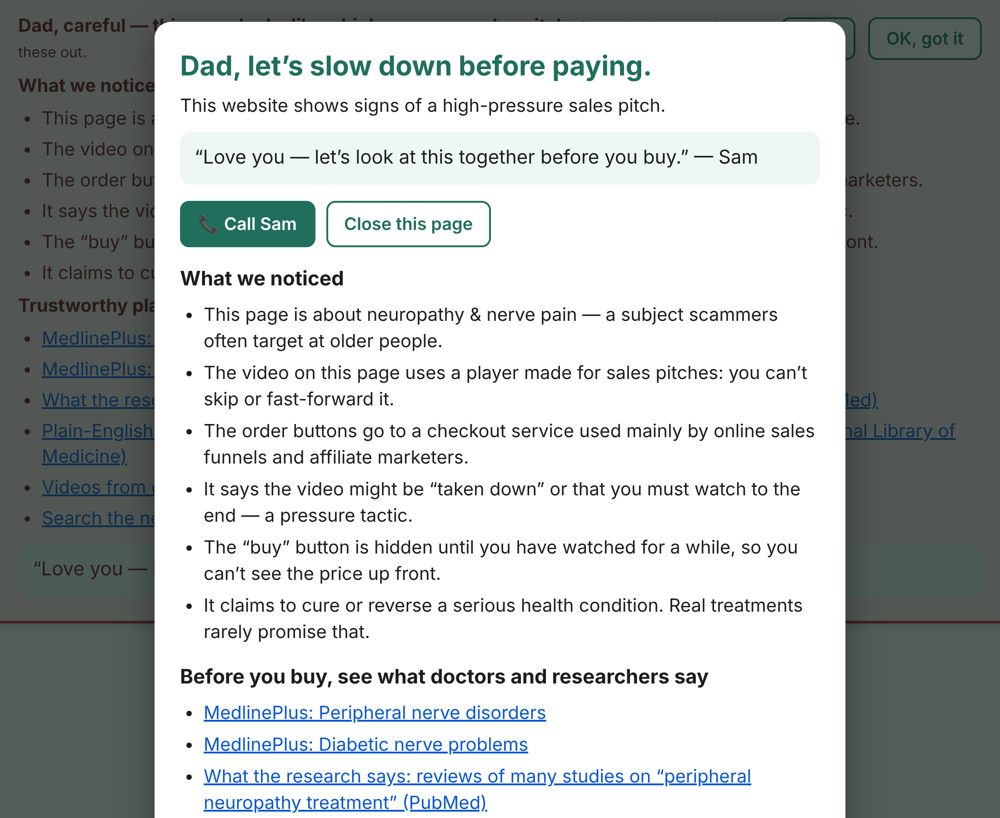

# ElderSafety

**Caregiver-managed guardrails for Chrome and Edge that slow down scams aimed at older adults** —
without spying on them or taking away their independence.

Built for an 83-year-old dad and his partner, shared for anyone with the same worry. Teaching
people to be careful isn't enough; this keeps a calm, familiar second opinion at the moments that
matter: when a late-night video sales pitch is about to get a credit card number, or a fake virus
warning says "call this number now".



## What it does
- **Spots high-pressure sales pages**: unskippable "video sales letter" players, buy buttons that
  only appear after minutes of video, very long single-column advertorials, miracle-cure claims,
  countdown timers and "only 3 left", 6-bottle bundles, and checkout networks used by affiliate
  funnels (ClickBank, Digistore24, BuyGoods…). → [docs/signals.md](docs/signals.md)
- **Pauses payment, not reading.** On a risky page, typing a card number brings up a "let's slow
  down" screen with *your* photo, name and message, a Call button, and the choice to wait 24 hours
  or ask you for an unlock code.
- **Points to better sources**: MedlinePlus, NIH, Mayo-type resources, a PubMed search limited to
  systematic reviews (many studies, not one), doctor videos, and a news search for complaints about
  the product.
- **Extra care on scam-prone topics** ("greylist"): ~40 subjects like neuropathy, tinnitus, blood
  sugar, memory, libido, gold IRAs, crypto, Medicare cards — each with a documented scam score.
  A topic alone never triggers a warning. → [docs/greylist-methodology.md](docs/greylist-methodology.md)
- **Stops fake tech support**: full-screen "this is a fake warning" on "your PC is infected — call
  1-8xx" pages, and "did someone ask you to install this?" on AnyDesk/TeamViewer-style downloads.
- **Emotional brakes**: every warning says *if anyone on the phone tells you to turn this off, it's a
  scam — call [you]*. If it's removed, the browser opens a page saying the same.
- **Private by design**: no browsing history, no telemetry, no reports back to you. Personal details
  and photo stay on their computer. The public repo has no family data.
- **Hands-off updates**: auto-updates from the stores, a weekly update check, and scam-topic data
  refreshed every 6 hours from this repo. Optional remote family settings from a secret Gist.

Plus a **Windows hardening kit** ([hardening/](hardening/README.md)) — free settings that stop most
"malware" (website notifications, dangerous downloads, click-through warnings) — and an
[anti-malware guide](docs/anti-malware.md) (Defender + DNS filtering beats paid antivirus).

## Getting started
- Caregivers: [docs/caregiver-guide.md](docs/caregiver-guide.md), [docs/install-windows.md](docs/install-windows.md)
- Phones/tablets: [docs/mobile.md](docs/mobile.md)
- Prior art: [docs/research.md](docs/research.md)

## Development
```bash
npm install
npm run build        # → dist/ (Load unpacked in chrome://extensions or edge://extensions)
npm test             # unit tests against tests/fixtures
npm run e2e          # loads the extension in Chromium and checks banners, the pause and unlock
npm run validate-data
```
Layout: `extension/src/modules/salespage` and `scamguard` hold the signals,
`shared/scorer.ts` combines them, `ui/` draws the warnings, `background/service-worker.ts` handles
sync, cooling-off and unlock codes, `setup/` is the settings page. Scam-topic data is generated from
`scripts/greylist-source.mjs`.

## Roadmap
- **Phase 2**: Mail guard for Gmail and Yahoo Mail, caregiver-defined topic nudges ("read anyway /
  share with partner"), review-pattern and domain-age signals, `check-and-harden.ps1`, store listings,
  optional AI second opinion with the caregiver's API key.
- **Phase 3**: NextDNS blocklist from the family config for phones; Safari packaging.

Apolitical by design: the code ships no political or ideological categories. Any personal "topics to
be careful with" are defined by each family in their own config.

MIT licensed.
