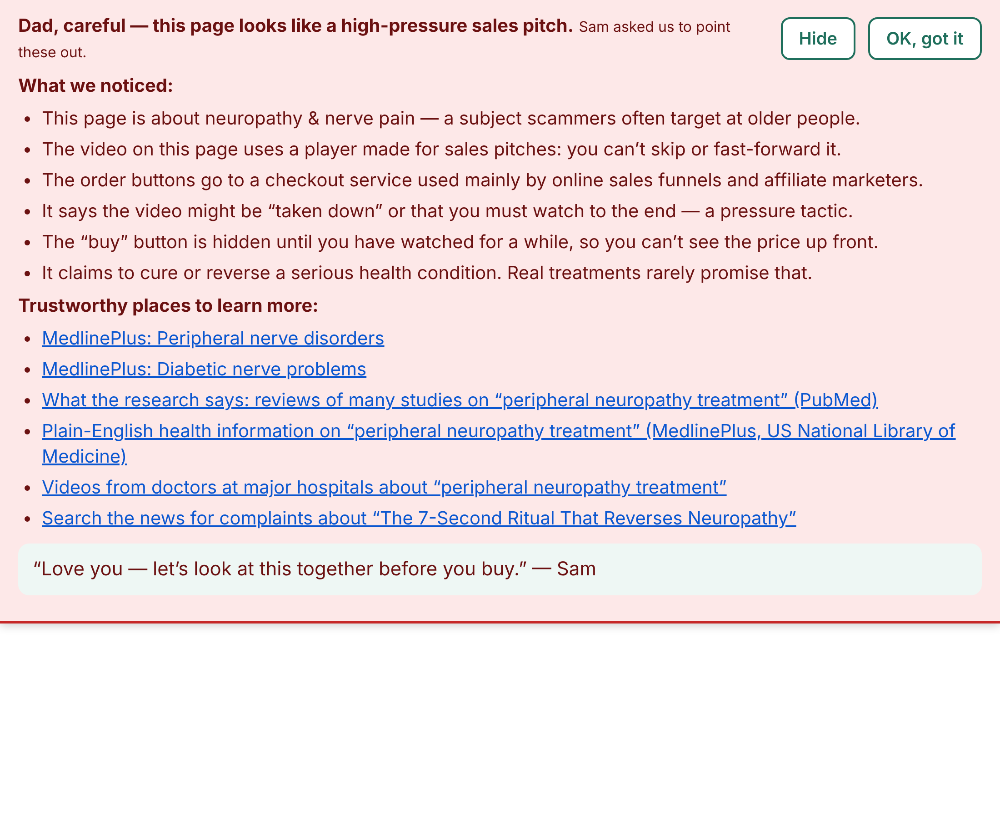
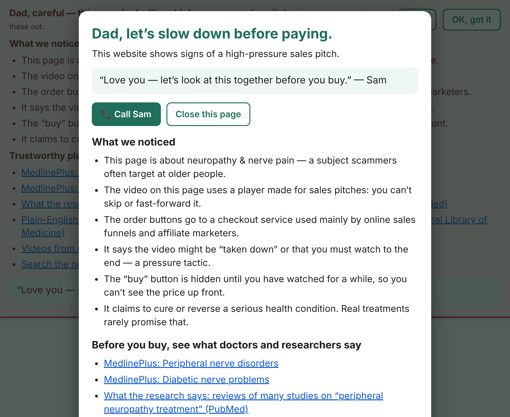

# Caregiver guide

ElderSafety is a gentle second opinion, not a cage. It never records browsing history, never
reports what they read, and never blocks reading — it only slows down **paying** on pages that look
like high-pressure sales, and stops fake virus pages.

## What they'll see
- **A banner** on pages using sales-pressure tricks, with a "Why?" button listing what was noticed
  and trustworthy places to learn about the same subject.
- **A pause** if they start typing a card number on such a page: your photo and message, a "Call
  you" button, and the choice to wait (24 hours by default) or ask you for the unlock code.
- **A full-screen warning** on fake "your computer is infected" pages and on remote-control
  download pages.

## The personal touch (most important part)
The most likely way protection gets switched off is a scammer on the phone saying "turn off that
extension". Every warning says: *if anyone on the phone tells you to ignore this or turn it off,
it's a scam — hang up and call you*. Your photo and message make that land. If the extension is
removed, the browser opens a page asking "Did someone ask you to do this? Call [you]".
Talk them through it once in person: "If you see my face, give me a ring."

## Remote settings (optional)
1. Copy `config/config.example.json`.
2. Create a **secret** GitHub Gist (gist.github.com → "Create secret gist") with it. Secret gists
   aren't listed or searchable, but anyone with the link can read them — don't put names, phone
   numbers or anything personal in it.
3. Click **Raw**, copy that URL, paste it into the extension's settings page on their PC.
   The extension re-reads it every 6 hours. Use the Raw URL *without* the commit hash in it so edits
   are picked up.

### Config options
| Key | What it does |
|---|---|
| `strictness` | `gentle`, `standard` or `strict` |
| `modules` | Turn `salespage` / `scamguard` on or off |
| `allowlist` | Sites you trust: no warnings, no pauses (subdomains included) |
| `denylist` | Sites to always treat as high risk (optional, empty by default) |
| `allowedRemoteAccess` | Remote-help tools you use, e.g. `["rustdesk.com"]` |
| `coolingOffHours` | Wait before a paused purchase can go ahead (1–168, default 24) |
| `unlockCodeHash`, `unlockCodeSalt` | An unlock code that works on every computer using this config. Generate with `npm run hash-code -- 1234`. Anyone who has the Gist link could work out a short code from its hash, so use 6+ digits here — or set the code on the settings page instead (stays on that PC). |
| `topicOverrides` | Change how much a scam topic counts, e.g. `{"gold-ira": 95}` |

## Checking it's working
On their PC, click the ElderSafety icon → settings (PIN). The Status box shows the version and
when data and config were last updated. Nothing is ever sent from their computer to you.
